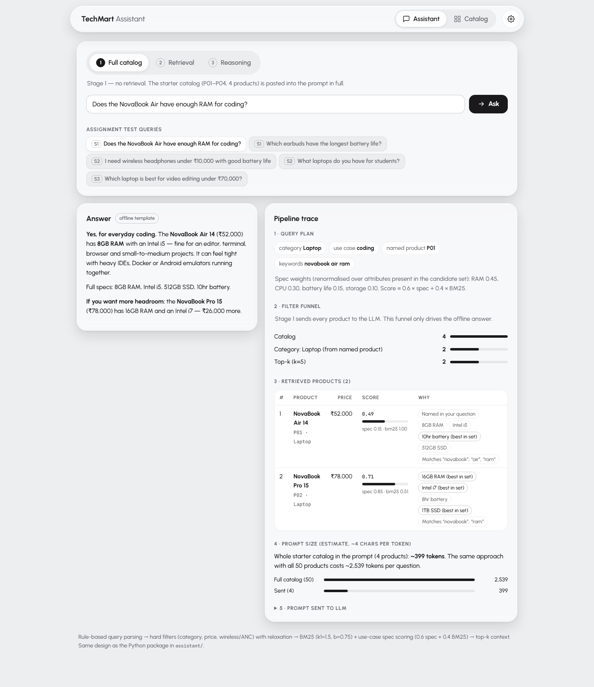
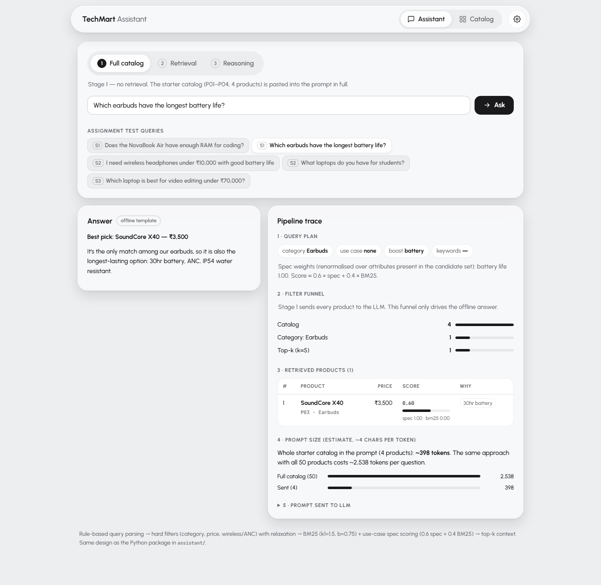
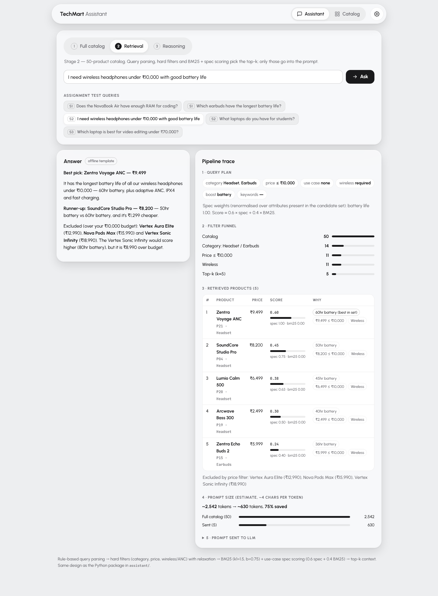
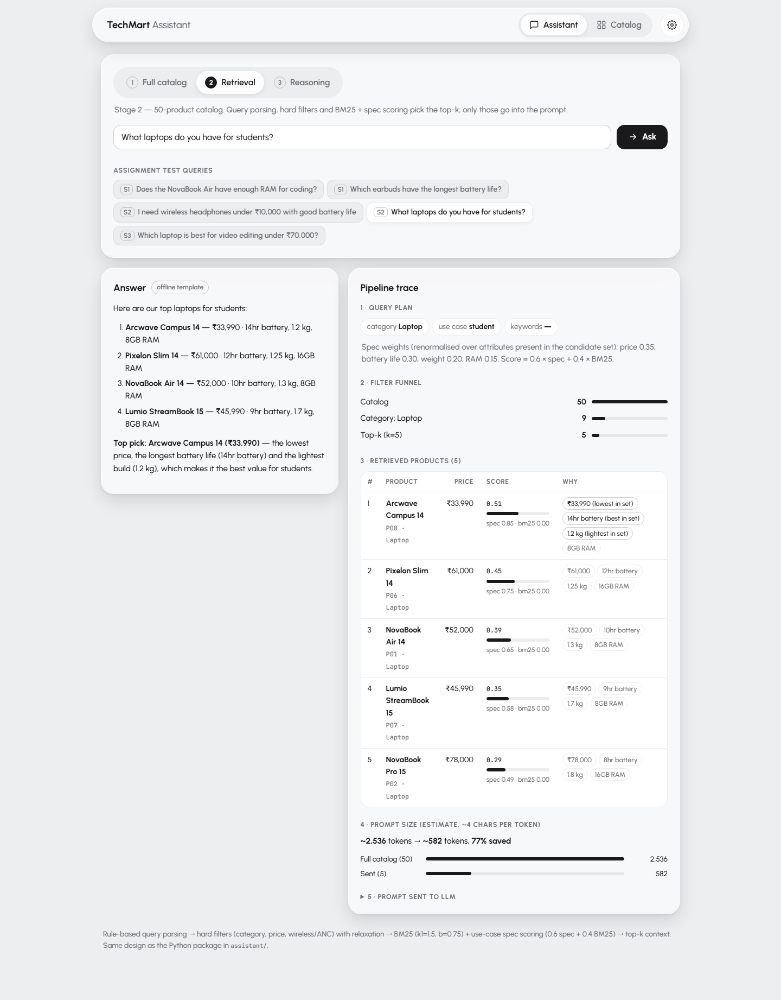
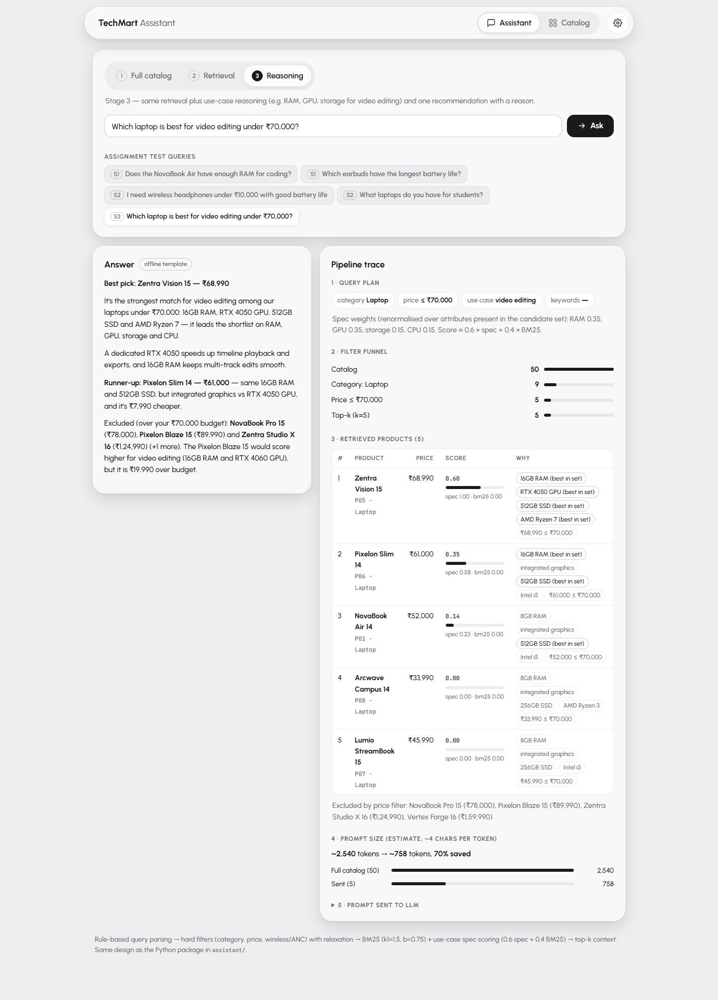
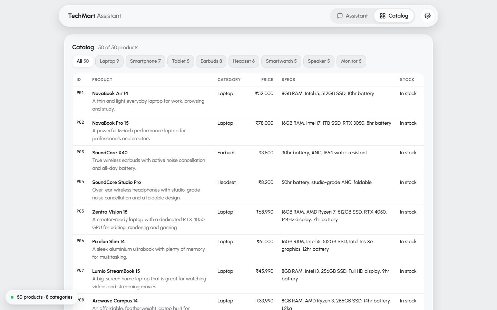
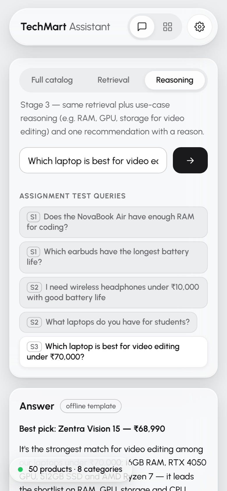

# TechMart Product Assistant

A question-answering assistant for TechMart, a (fictional) Indian electronics shop. A customer types a question
in plain English, such as "Which laptop is best for video editing under ₹70,000?". The assistant finds the right
products in the shop's catalog and writes a short answer. It only uses facts from the catalog. It never makes up
products, prices or specs. The project has two parts that follow the same logic: a Python package with a command
line tool and tests, and a static web demo that runs fully in the browser.

## Live demo

**https://vsxye.github.io/odysseus/**

- It works without an API key. In that case it uses the "offline" answer mode: the answer is built from a
  fixed template filled with the ranked products. No LLM is called.
- To get real LLM answers, paste your own Anthropic API key into the page. The key stays in your browser. It is
  sent only to `api.anthropic.com`, and it is not saved on any server.

## Run it on your own laptop (one click)

This works on Windows. You do not need to install Python or anything else first.

1. On the GitHub page, click **Code**, then **Download ZIP**.
2. Extract the ZIP to any folder (right-click, **Extract All**).
3. Open the folder and double-click **`run.bat`**.

The first run takes a few minutes because it downloads what it needs. Later runs start in a few seconds.

Windows SmartScreen may warn you because the `.bat` file came from the internet. Click **More info**, then
**Run anyway**.

### What `run.bat` does, and why

1. **Downloads a portable Python 3.12** (about 15 MB, from NuGet) into a `.runtime\` folder inside the project.
   Why: it never touches any Python you already have. It does not change your PATH or the registry, and it does
   not run an installer.
2. **Creates an isolated virtual environment** in `.venv\`. Why: the project's packages stay inside this folder
   and cannot clash with anything else on your PC.
3. **Installs `requirements.txt`** into that environment. It only does this again if the file changes.
4. **Installs Ollama and the `qwen2.5:3b` model** (about 2 GB). Ollama is a free, open-source program that runs
   an LLM on your own laptop. It is installed for your user only. Why: you get real LLM answers with no API key
   and no cost. If you do not want this, set `TECHMART_SKIP_LLM=1` before running `run.bat`. The app then uses
   the offline rule-based answers.
5. **Starts `scripts/serve.py`** on the first free port from 8000 and opens the demo in your browser.

To stop it, close the black console window.

**Uninstall:** delete the project folder. If you also want to remove Ollama, uninstall it from Windows
**Settings > Apps**.

### Optional: faster answers with Gemini

The local model is free but can be slow on an older laptop. For faster answers, create a file called `.env` in
the project folder (next to `run.bat`) with your Google Gemini API key(s):

```
GEMINI_API_KEYS=key1,key2
GEMINI_MODEL=gemini-flash-lite-latest,gemini-3.5-flash
```

`GEMINI_MODEL` is optional (default: `gemini-flash-lite-latest`, then `gemini-3.5-flash`; comma-separated, tried in order). You can list several keys separated by commas.
If one key hits a rate limit or an error (429, 403 or 5xx), the server moves on to the next key. Restart
`run.bat` after creating the file. Never commit `.env` to git. It is already in `.gitignore`.

### Command line: `ask.bat`

After `run.bat` has run once, you can also use the command line version:

```
ask.bat                                                  runs the five assignment questions
ask.bat "Which earbuds have the longest battery life?"   answers one question
```

For real LLM answers on the command line, run `set ANTHROPIC_API_KEY=sk-ant-...` in the same window first.

## Answer sources

When you ask a question in the web demo, the answer comes from the first of these that is available:

1. **Your Anthropic API key**, if you paste one into the page. The browser calls Anthropic directly.
2. **The server's LLM**, when the page is served by `scripts/serve.py`. This is Google Gemini if `.env` has
   `GEMINI_API_KEYS`, otherwise the local Ollama model `qwen2.5:3b`. The keys stay on the server. The browser
   never sees them; it only calls `/api/llm` on the local server. `/api/health` shows which provider and model
   are in use.
3. **The offline rule-based answer**, if no LLM is available. It is built from a template filled with the ranked
   products.

The product search and ranking are the same in all three cases. Only the final wording changes.

## Sharing it from your laptop with Cloudflare

To let someone else try the demo running on your laptop, install
[cloudflared](https://developers.cloudflare.com/cloudflare-one/connections/connect-networks/downloads/) and run:

```
cloudflared tunnel --url http://localhost:8000
```

It prints a temporary `https://<random-name>.trycloudflare.com` link. Add `/web/` to the end and share it. The link
works only while your laptop is on and both `run.bat` and `cloudflared` are running. If `serve.py` picked a port
other than 8000, use that port instead. Anyone with the link uses your server's LLM (your Gemini keys or your
local Ollama), so share it only with people you trust.

## Screenshots

| | |
|---|---|
|  |  |
| Stage 1: "Does the NovaBook Air have enough RAM for coding?" | Stage 1: "Which earbuds have the longest battery life?" |
|  |  |
| Stage 2: wireless headphones under ₹10,000 with good battery | Stage 2: "What laptops do you have for students?" |
|  |  |
| Stage 3: best laptop for video editing under ₹70,000, with the parsed query and ranking shown | The catalog browser with all 50 products |
|  | |
| The Stage 3 answer on a phone screen | |

## The assignment in brief

Build a product Q&A assistant for TechMart. Answers must come only from the catalog. The work is split into stages.

| Stage | What changes | Test questions |
|---|---|---|
| 1 | Small catalog (4 products). Put the question and the whole catalog in the prompt and let the LLM answer. | "Does the NovaBook Air have enough RAM for coding?"<br>"Which earbuds have the longest battery life?" |
| 2 | Catalog grows to 50 products in 8 categories. Pasting everything into the prompt is now wasteful, so add a retrieval step: only the most relevant products go to the LLM. | "I need wireless headphones under ₹10,000 with good battery life"<br>"What laptops do you have for students?" |
| 3 | Questions now carry constraints and a purpose. A price limit must be a hard filter, and products must be ranked by the specs that matter for the job. The answer must be one recommendation with a reason, not a list. | "Which laptop is best for video editing under ₹70,000?" |
| 4 | No code. Explain how the design would change for 50,000+ products. | See [Scaling to 50,000+ products](#scaling-to-50000-products-stage-4) |

## How it works

```
 customer question
        |
        v
 1. PARSE        rules turn the text into a QueryPlan:
        |        category, price range, use case, wireless/ANC, named product, keywords
        v
 2. FILTER       drop every product that breaks a hard rule
        |        (wrong category, over budget, not wireless ...). If nothing is left, relax.
        v
 3. RANK         score the products that are left:
        |        BM25 text match + spec score for the use case (e.g. video editing)
        v
 4. PROMPT       top 5 products + the rules ("answer only from this catalog")
        |
        v
 5. ANSWER       Anthropic LLM  --or--  offline template (no API key)
        |
        v
 answer + trace (parsed plan, ranked products, reasons, excluded products, token estimate)
```

The same pipeline exists twice: in Python (`assistant/`) and in JavaScript (`web/engine.js`), so the web demo
can run on GitHub Pages with no server.

### Step 1: Parse the question (`assistant/query_parser.py`)

**What.** `parse_query(question, catalog)` reads the question with regular expressions and word lists, and returns a
`QueryPlan`. The plan holds:

- `categories`: "laptop", "notebook" -> Laptop; "earbuds", "tws" -> Earbuds; "phone", "mobile" -> Smartphone, and so
  on. "Headphones" is a generic word, so it maps to both Headset and Earbuds.
- `price_max` / `price_min`: understands "under ₹70,000", "below 70k", "Rs 70000", "up to 1.2 lakh",
  "above 20k", "between 10k and 20k". A plain number like "16" or "15 inch" is not read as a price.
- `use_case`: video editing, gaming, students, coding, travel or workouts, found by keywords
  ("premiere", "render", "college", "programming", "gym" ...).
- `need_wireless`, `need_anc`, `wants_battery`.
- `sort_by`: superlatives like "longest battery", "cheapest", "most RAM", "lightest".
- `pinned_ids`: products named in the question ("NovaBook Air" -> P01).
- `unknown_products`: names that are not in the catalog ("iPhone 15", "MacBook"), so the answer can say
  "We don't carry it".
- `intent`: `product_question`, `superlative`, `recommend`, `browse` or `search`. This picks the answer style.
- `keywords`: the remaining words, for the text search. Each use case also adds a few related words
  (`expansions`), for example "students" adds "affordable", "featherweight", "study".

**Why rules and not an LLM?** Rules are instant, free, and always give the same result, which makes them easy to
test. The questions in this shop have a small, predictable shape (category + budget + purpose). An LLM parser
would add a second API call and a second point of failure for every question. For a much larger shop, an LLM
parser becomes worth it (see Stage 4).

### Step 2: Hard filters (`retrieval.py`, `_passes`)

**What.** Before any ranking, remove every product that breaks a rule the customer stated: wrong category, price
outside the range, not wireless when "wireless" was asked, no ANC when "noise cancelling" was asked.

**Why filter first?** "Under ₹70,000" is a constraint, not a keyword. A text search treats it as just more words.
A pure text search for "laptop best for video editing under 70000" ranks the NovaBook Pro 15 (₹78,000) and the
Zentra Studio X 16 (₹1,24,990, "for 4K video editing") very high, and it also likes the Lumio StreamBook 15
because its description says "great for watching videos". All three are wrong answers. A budget is a yes/no rule,
so it is applied as a yes/no filter.

**Relaxation.** If the filters remove everything (for example "laptop under ₹10,000"), the system drops the price
filter but keeps the category, then drops the wireless/ANC filters if needed. It marks the result `relaxed`, and the
answer starts by saying that nothing matched exactly. Saying "nothing matched, here is the closest" is more helpful
than an empty reply, and more honest than pretending the closest option fits.

**Excluded products.** For a budget question, the system also remembers the same-category products that failed only
because of price, closest to the budget first. The answer can then say "NovaBook Pro 15 (₹78,000) is over budget",
which explains why a well-known product is missing.

### Step 3: Rank (`retrieval.py`, `retrieve`)

Two signals are combined.

**a) BM25 text score.** BM25 is the standard keyword-ranking formula used by search engines (k1 = 1.5, b = 0.75).
It indexes `name + category + brand + specs + description` of each product. It rewards rare, matching words
("rendering", "featherweight") more than common ones ("laptop"), and it does not over-reward long descriptions.

*Why BM25?* It needs no model, no GPU, and no external service. It is a few dozen lines of code, gives the same
result in Python and JavaScript, and is easy to explain ("it matched the words rendering and creator"). For 50
products with short, keyword-rich specs, it works well.

**b) Spec score for the use case (Stage 3).** Each use case has a weight profile: which product attributes matter and
how much.

| Use case | Weights |
|---|---|
| Video editing | RAM 0.35, GPU tier 0.35, storage 0.15, CPU 0.15 |
| Gaming | GPU 0.45, RAM 0.25, refresh rate 0.15, CPU 0.15 |
| Students | low price 0.35, battery 0.30, low weight 0.20, RAM 0.15 |
| Coding | RAM 0.45, CPU 0.30, battery 0.15, storage 0.10 |
| Travel | battery 0.45, low weight 0.30, ANC 0.25 |
| Workouts | water resistance 0.5, battery 0.3, low price 0.2 |

If the question also says "good battery" or "long battery", 0.4 is added to the battery weight. The weights are
then rescaled so they add up to 1.

The CPU name is turned into a number: i3 / Ryzen 3 = 0.3, i5 / Ryzen 5 / Apple M-base = 0.6, i7 / Ryzen 7 = 0.85,
i9 / Ryzen 9 = 1.0. The GPU uses a tier stored in the catalog: 0 integrated, 1 entry (RTX 3050), 2 mid
(RTX 4050/4060), 3 high (RTX 4070+).

*Why weight profiles?* "Best for video editing" is not a word you can search for. It means "lots of RAM and a real
GPU". A profile turns that meaning into numbers. Profiles are short, readable, and easy to change after feedback.

*Why min-max normalization over the candidates?* RAM is in GB (8 to 32), price is in rupees (thousands), GPU tier is
0 to 3. To add them, each attribute is rescaled to 0..1: the best product among the remaining candidates gets 1,
the worst gets 0. This is done after filtering, on purpose. "Best RAM" should mean "best RAM among the laptops you
can actually afford", not compared with a ₹1,60,000 laptop that was already removed. It also produces clear reasons
like "16GB RAM (best in set)".

**c) The final score.**

| Situation | Score |
|---|---|
| A use case was found (Stage 3) | `0.6 × spec score + 0.4 × BM25` |
| Only a battery wish ("good battery"), no use case | `0.7 × spec score + 0.3 × BM25` |
| Neither | `BM25` only |

BM25 scores are divided by the top BM25 score among the candidates, so both parts are on a 0..1 scale.

The sort order is: products named in the question first, then the superlative attribute if one was asked
("longest battery" sorts by battery hours), then the score, then the lower price.

Every product carries a `why` list, for example
`16GB RAM (best in set); RTX 4050 GPU (best in set); ₹68,990 ≤ ₹70,000; matches: laptop, editing, creator`.
These reasons are shown in the CLI and the web demo, and they are also sent to the LLM.

### Step 4: Build the prompt (`assistant/llm.py`)

**What.** The prompt has a fixed system message plus the top 5 products (one compact line each, with score and
reasons), the filters that were applied, any relaxation note, the products excluded by budget, and the question.

The system message tells the model to:

1. answer only from the catalog in the prompt;
2. quote product names with their exact price;
3. say "we don't carry X" for anything not in the catalog, and offer the closest real product;
4. for "best"/"which should I buy" questions, give one pick with a reason, an optional runner-up, and mention
   what the budget excluded, instead of dumping a list;
5. respect the hard filters, and say so if they were relaxed;
6. be short (2-6 sentences).

**Why only the top 5 products, not all 50?** Cost and focus. The full 50-product catalog is about 2,500 prompt
tokens per question. The top 5 is about 600 to 800 tokens, roughly 3 to 4 times less (the web demo shows this
saving for every question). At 50,000 products the full
catalog would not fit in any prompt. A smaller context also leaves the model fewer wrong products to pick from.

**Why the "catalog only" rules?** A shop assistant that invents a spec or a price is worse than useless. The model
only sees real catalog lines, and the rules tell it what to do when the answer is not there. Giving it the
pre-computed reasons ("best in set", "over budget") also means the model explains a ranking that was already
computed correctly, instead of redoing the comparison itself.

### Step 5: Answer (LLM or offline)

**LLM mode.** `call_llm()` calls the Anthropic Messages API. The default model is `claude-haiku-5-5` (small, fast,
cheap; the hard work is already done by retrieval). Set `TECHMART_MODEL` to use a different model. The key comes from
`ANTHROPIC_API_KEY`.

**Offline mode.** `offline_answer()` writes the answer from templates and the ranked list. There is one template per
intent: a product question (for example, the RAM verdict for the NovaBook Air), a superlative, a recommendation (pick +
reason + runner-up + excluded), and a list.

**Why an offline mode?**

- The demo and the tests run without an API key, without network, and without cost.
- The output is the same every time, so tests can check exact facts.
- If the API call fails (no key, network error, rate limit), the assistant still answers instead of crashing.
- It proves that the retrieval and ranking are correct on their own. The LLM only words the answer.

## Stage-by-stage walkthrough

The outputs below are real, from `python -m assistant --demo --offline` (offline mode, so no LLM wording). The same
output is saved in [docs/sample_outputs.md](docs/sample_outputs.md). With an API key, the LLM gets the same products
and writes the final answer in its own words. The web demo uses the same products and reasons, but its offline
answers are worded a little differently.

### Stage 1, question 1: "Does the NovaBook Air have enough RAM for coding?"

- **Mode:** no retrieval. Stage 1 recreates the assignment's starting point: the 4 starter products (P01-P04) go
  into the prompt in full, about 450 prompt tokens.
- **Parsed:** intent `product_question`, product P01 (NovaBook Air 14) found by name, use case `coding`, asked
  attribute `ram`.
- **Answer:**
  > The NovaBook Air 14 (₹52,000) has 8GB RAM, Intel i5, 512GB SSD, 10hr battery. For light coding — VS Code,
  > Python/JavaScript, web development and coursework — 8GB RAM is enough. For heavier work (large IDEs like IntelliJ
  > or Android Studio, Docker containers, VMs, many browser tabs) 16GB is noticeably better, and the RAM is the limit
  > here. If you need 16GB, the closest option in our catalog is the NovaBook Pro 15 (₹78,000) with 16GB RAM, Intel
  > i7 and RTX 3050 GPU.
- **Why this answer:** it gives an honest "it depends" with a clear line (light vs heavy coding), and points to the
  16GB laptop in the catalog as the upgrade. Asked in Stage 2 or 3 (full 50-product catalog), the suggested upgrade
  becomes the cheaper Pixelon Slim 14 (₹61,000, 16GB RAM).

### Stage 1, question 2: "Which earbuds have the longest battery life?"

- **Parsed:** category Earbuds, superlative `battery_hr` (highest first).
- **Answer:**
  > The earbuds with the longest battery life are the SoundCore X40 (₹3,500) with 30hr battery (ANC, IP54).
- **Note:** "Earbuds" means only Earbuds. The SoundCore Studio Pro has a longer battery (50hr), but it is an
  over-ear headset, so it is correctly left out. The SoundCore X40 is the only earbud in the starter catalog. With the
  full catalog (`--stage 3`), the answer becomes the Vertex Aura Elite (₹12,990, 45hr), then the Nova Pods Max
  (₹15,990, 40hr) and the Zentra Echo Buds 2 (₹5,999, 36hr).

### Stage 2, question 1: "I need wireless headphones under ₹10,000 with good battery life"

- **Mode:** retrieval. 5 products in the prompt, about 650 tokens (vs about 2,500 for the full catalog).
- **Parsed:** categories Headset + Earbuds ("headphones" is generic), price at most ₹10,000, wireless, battery wish.
- **Filter:** 11 of 50 products pass. The Vertex Sonic Infinity (80hr, ₹18,990), Vertex Aura Elite (45hr, ₹12,990)
  and Nova Pods Max (40hr, ₹15,990) have the best batteries but are over budget, so they are removed.
- **Ranked:** Zentra Voyage ANC (60hr, ₹9,499), SoundCore Studio Pro (50hr, ₹8,200), Arcwave Bass 300 (40hr,
  ₹2,499), Lumio Calm 500 (45hr, ₹6,499), SoundCore X40 (30hr, ₹3,500).
- **Answer:**
  > Here are our wireless headphones under ₹10,000, best battery life first: 1. Zentra Voyage ANC (₹9,499) — 60hr
  > battery, ANC 2. SoundCore Studio Pro (₹8,200) — 50hr battery, ANC 3. Arcwave Bass 300 (₹2,499) — 40hr battery
  > 4. Lumio Calm 500 (₹6,499) — 45hr battery, ANC 5. SoundCore X40 (₹3,500) — 30hr battery, ANC. Top pick: the
  > Zentra Voyage ANC, with the longest battery (60hr battery) in this range.
- **Note:** the order mixes battery (70%) with text match (30%), so the Arcwave Bass 300 (it literally says
  "wireless headphones") sits just above the Lumio Calm 500 even though its battery is 5 hours shorter.

### Stage 2, question 2: "What laptops do you have for students?"

- **Parsed:** category Laptop, use case `student`, intent `browse`.
- **Ranking:** Stage 2 uses BM25 only (the spec profiles start in Stage 3). The "students" use case adds the search
  words "affordable", "featherweight", "study", "light" and "everyday", which pull up the right laptops.
- **Ranked:** NovaBook Air 14 (₹52,000), Arcwave Campus 14 (₹33,990), then NovaBook Pro 15, Lumio StreamBook 15,
  Pixelon Blaze 15.
- **Answer (end):**
  > For students on a budget, the Arcwave Campus 14 (₹33,990) is the most affordable and also has the longest
  > battery (14hr battery). Lightest: Arcwave Campus 14 (1.2kg).
- **Note:** this question shows the limit of text search alone. The ₹89,990 gaming laptop is in the top 5 just
  because it is a laptop. Running the same question with `--stage 3` turns on the student profile (low price,
  battery, weight, RAM). Then the Arcwave Campus 14 is first ("lowest price in set", "14hr battery (best in set)",
  "1.2kg (lightest in set)"), the NovaBook Air 14 second, and the answer becomes one pick plus a runner-up:
  > Best pick for students: Arcwave Campus 14 (₹33,990) — 14hr battery, 1.2kg, 8GB RAM. It scores highest on our
  > spec profile: for students it balances a low price, long battery life and a light build. Runner-up: NovaBook Air
  > 14 (₹52,000) — 10hr battery, 1.3kg, 8GB RAM. Trade-off: shorter battery (10hr battery vs 14hr), heavier (1.3kg).

### Stage 3: "Which laptop is best for video editing under ₹70,000?"

- **Mode:** full pipeline. 5 products in the prompt, about 780 tokens.
- **Parsed:** category Laptop, price at most ₹70,000, use case `video_editing`, intent `recommend`.
- **Profile:** RAM 0.35, GPU 0.35, storage 0.15, CPU 0.15.
- **Filter:** 5 of the 9 laptops are under ₹70,000. Excluded by budget: NovaBook Pro 15 (₹78,000), Pixelon Blaze 15
  (₹89,990), Zentra Studio X 16 (₹1,24,990).
- **Ranked:**

| # | Product | Price | Score | Why |
|---|---|---|---|---|
| 1 | Zentra Vision 15 | ₹68,990 | 1.000 | 16GB RAM, RTX 4050, 512GB, Ryzen 7 (best in set on all four) |
| 2 | Pixelon Slim 14 | ₹61,000 | 0.417 | 16GB RAM, but integrated graphics |
| 3 | NovaBook Air 14 | ₹52,000 | 0.241 | 8GB RAM, integrated graphics |
| 4 | Lumio StreamBook 15 | ₹45,990 | 0.189 | 8GB RAM, i3 ("great for watching videos" is not editing) |
| 5 | Arcwave Campus 14 | ₹33,990 | 0.095 | 8GB RAM, Ryzen 3 |

- **Answer:**
  > Best pick for video editing under ₹70,000: Zentra Vision 15 (₹68,990) — 16GB RAM, RTX 4050 GPU, 512GB storage,
  > AMD Ryzen 7. It scores highest on our spec profile: for video editing the dedicated GPU accelerates rendering and
  > exports, and the RAM keeps timeline scrubbing smooth. Runner-up: Pixelon Slim 14 (₹61,000) — 16GB RAM,
  > integrated graphics, 512GB storage, Intel i5 (₹7,990 cheaper, longer battery (12hr battery); but integrated
  > graphics instead of RTX 4050). Excluded: NovaBook Pro 15 (₹78,000) and Pixelon Blaze 15 (₹89,990) are over budget.
- **Why this is right:** one pick, a reason tied to specs, a runner-up with its trade-off, and a note on why the
  stronger laptops are missing.

## The catalog (`data/products.json`)

50 fictional products in 8 categories. One JSON file is used by both the Python code and the web demo.

| Category | Count | Price range |
|---|---|---|
| Laptop | 9 | ₹33,990 – ₹1,59,990 |
| Earbuds | 8 | ₹1,499 – ₹15,990 |
| Headset | 6 | ₹2,499 – ₹18,990 |
| Smartphone | 7 | ₹11,999 – ₹89,999 |
| Tablet | 5 | ₹11,499 – ₹64,999 |
| Smartwatch | 5 | ₹2,499 – ₹34,999 |
| Speaker | 5 | ₹1,999 – ₹19,999 |
| Monitor | 5 | ₹9,999 – ₹89,999 |

The first four products (P01-P04) are exactly the Stage 1 starter catalog: NovaBook Air 14, NovaBook Pro 15,
SoundCore X40, SoundCore Studio Pro.

Each product has a human-readable `specs` string (for text search and the prompt) and a structured `attributes`
object (`ram_gb`, `gpu_tier`, `battery_hr`, `weight_kg`, `anc`, `wireless`, `water_resistance`, ...) for filtering
and scoring. Text is for matching words; numbers are for comparing.

**Deliberate traps.** Some products were added on purpose to catch a naive solution:

| Trap | Product | What a naive system does wrong |
|---|---|---|
| Right specs, just over budget | NovaBook Pro 15 (₹78,000, 16GB, RTX 3050), Zentra Studio X 16 (₹1,24,990, "for 4K video editing") | Recommends them for "video editing under ₹70,000" |
| Word match, wrong meaning | Lumio StreamBook 15: "great for watching videos" | Text search matches "video" and ranks it for video editing |
| Same RAM, no GPU | Pixelon Slim 14 (₹61,000, 16GB, integrated graphics) | Looks equal to the right pick if you only compare RAM |
| The right answer | Zentra Vision 15 (₹68,990, 16GB, RTX 4050) | Only found if budget, RAM and GPU are all considered |
| Best battery, over budget | Vertex Sonic Infinity (80hr, ₹18,990), Vertex Aura Elite (45hr, ₹12,990), Nova Pods Max (₹15,990) | Recommends them for "headphones under ₹10,000 with good battery" |
| Headset vs earbuds | SoundCore Studio Pro (50hr) and Zentra Voyage ANC (60hr) are headsets | Answers "longest battery earbuds" with a headset |
| Student laptop | Arcwave Campus 14 (₹33,990, 14hr, 1.2kg) | Missed if "students" is not linked to price, battery and weight |

## Project structure

```
data/products.json        the catalog: 50 products, used by Python and the web demo
assistant/
  __init__.py             public API: answer, load_catalog, parse_query, retrieve, Product, QueryPlan
  __main__.py             lets you run `python -m assistant`
  catalog.py              Product dataclass, load_catalog(), product_to_text(), format_inr() (₹1,24,990 style)
  query_parser.py         parse_query(): question -> QueryPlan (category, price, use case, flags, names, intent)
  retrieval.py            retrieve(): hard filters + relaxation, BM25, use-case spec scoring, why-reasons
  llm.py                  SYSTEM_PROMPT, build_user_prompt(), call_llm() (Anthropic), offline_answer()
  assistant.py            answer(question, stage, top_k, offline): runs the pipeline, returns answer + trace
  cli.py                  command line tool: --stage --offline --k --json --trace --demo
tests/
  conftest.py             removes ANTHROPIC_API_KEY so every test runs offline; shared catalog fixtures
  test_query_parser.py    prices ("70k", "between"), "16GB" is not a price, categories, use cases, name pinning
  test_bm25.py            BM25 ranking, CPU score tiers, ₹ formatting, offline mode never imports the SDK
  test_retrieval.py       the five assignment questions end to end, lexical trap, relaxation, unknown products
web/
  index.html              the demo page
  styles.css              page styles (light and dark)
  engine.js               JavaScript port of the same pipeline (parse, filter, BM25, scoring, prompt, offline answer)
  app.js                  page logic: stage switch, example questions, API key box, trace view, catalog browser
index.html                redirects the site root to web/
docs/
  SPEC.md                 the shared design spec the code was built from
  sample_outputs.md       full output of `python -m assistant --demo --offline`
  screenshots/            screenshots used in this README
scripts/
  serve.py                local server for run.bat: serves the demo, /api/llm (Gemini or Ollama), /api/health
run.bat                   one-click Windows launcher (portable Python, .venv, Ollama, starts serve.py)
ask.bat                   command line version, uses the .venv that run.bat created
.env                      your Gemini keys (optional, you create it; gitignored, never committed)
requirements.txt          Python dependencies (anthropic, pytest)
pyproject.toml            package metadata and pytest settings
.nojekyll                 tells GitHub Pages to serve the files as they are
```

## Run it locally

You need Python 3.10 or newer. The `anthropic` package is only imported when a real LLM call is made, so offline
mode and the tests work even without it.

```bash
pip install -r requirements.txt

# ask one question (Stage 3 pipeline by default)
python -m assistant "Which laptop is best for video editing under ₹70,000?"

# run all five assignment questions, each in its own stage
python -m assistant --demo

# force the offline answer even if ANTHROPIC_API_KEY is set
python -m assistant --demo --offline

# other flags
python -m assistant "What laptops do you have for students?" --stage 2   # pick the stage (1, 2 or 3)
python -m assistant "best earbuds for the gym" --k 3                     # how many products to retrieve
python -m assistant "..." --json                                         # full result as JSON
python -m assistant "..." --trace                                        # also print the prompt and timing

# run the tests
python -m pytest -q
```

The test suite has 29 tests and they all pass (`29 passed`). They cover the five assignment questions, the
budget and category filters, the "watching videos" trap, relaxation when nothing matches, and the "we don't carry
the iPhone 15 Pro" guard.

For real LLM answers, set the key first:

```bash
export ANTHROPIC_API_KEY=sk-ant-...        # Windows PowerShell: $env:ANTHROPIC_API_KEY="sk-ant-..."
export TECHMART_MODEL=claude-haiku-5-5     # optional, this is the default
```

Without a key, the assistant uses offline mode automatically. If the API call fails, it also falls back to offline
mode and prints the error under the answer.

**Web demo.** The page loads `data/products.json`, so serve the repository root (opening the HTML file directly
will not work, because browsers block local file loading):

```bash
python -m http.server 8000
# open http://localhost:8000/web/
```

## Design decisions and trade-offs

**Hybrid search: structured filters + keyword ranking + spec scoring.** Each part does one job. Filters enforce
rules (budget, category). BM25 matches words. Spec profiles judge "good for X". Together they get all five test
questions right, and each step can be checked on its own in the trace.

**Alternatives considered:**

| Alternative | Why it was not chosen (at this size) |
|---|---|
| **Put the whole catalog in the prompt** (the Stage 1 approach) | Works for 4 products. At 50 it costs about 4 times more tokens per question, and at 50,000 it does not fit at all. The model also has to do the budget filtering itself, and it can get it wrong. |
| **Embeddings + vector database** | Good at meaning ("something for my commute" -> travel). But embeddings do not understand "under ₹70,000"; numbers are just text to them. You still need hard filters. For 50 products it adds a model, an index and a dependency, for little gain over BM25 + rules. It is the right move at scale, together with filters (see Stage 4). |
| **LLM parses the question into JSON** | More flexible with unusual wording. But it adds an extra API call (cost and delay) to every question, can fail, and is not deterministic, which makes testing harder. Rules cover the expected questions. At scale, an LLM parser with a rules fallback is the plan. |
| **Let the LLM do the filtering and ranking** | LLMs are bad at strict numeric rules over many items. They may recommend the ₹78,000 laptop "because it is only a bit over". Doing the arithmetic in code makes the rules exact; the LLM only explains the result. |
| **Fixed category templates instead of an LLM** | This is the offline mode. It is reliable but stiff. The LLM gives more natural answers and handles follow-up nuance, so both are kept. |

**Other trade-offs:**

- **Two implementations (Python + JavaScript).** The web demo must run on GitHub Pages with no server, so the engine
  is ported to JavaScript. The cost is keeping two copies in sync. Both follow `docs/SPEC.md` and pick the same
  top product for all five test questions. There are small differences: the web engine applies the use-case
  profile in Stage 2 too (so its Stage 2 student answer already puts the Arcwave Campus 14 first), it has a few
  extra boosts from words like "cheap", "light", "ANC" and "waterproof", and its offline answers are worded
  differently.
- **Hand-set weights.** The profile weights are reasoned, not learned. They are easy to read and change, but they are
  opinions. With real usage data they should be tuned against an evaluation set.
- **The key in the browser.** The web demo calls the Anthropic API directly from the browser (with the
  `anthropic-dangerous-direct-browser-access` header). This is fine for a demo where users paste their own key. A real
  shop would call the LLM from its own server and never expose a key.
- **Stage 1 uses only the 4 starter products.** This matches the assignment: pasting the whole catalog is fine at 4
  products. The web demo also shows how many tokens the full 50-product catalog would cost for each question.

## Scaling to 50,000+ products (Stage 4)

The shape of the pipeline stays the same: parse, filter, rank, prompt, answer. What changes is where each step runs.

1. **Search engine instead of in-memory lists.** Store products in a search engine that supports structured filters
   and text search together: Elasticsearch / OpenSearch, or Postgres with full-text search and indexes on price and
   category. Hard filters become indexed queries (`category = Laptop AND price <= 70000`) that take milliseconds.
2. **Hybrid search (keywords + meaning).** Add embeddings for each product and use a vector database or a search engine
   with vector support (OpenSearch k-NN, pgvector, Qdrant, Weaviate, Pinecone). Run BM25 and vector search together
   and merge the results (for example with reciprocal rank fusion). Embeddings catch meaning ("good for long flights");
   BM25 catches exact names and model numbers. Filters are always applied inside the search, not after.
3. **Two-stage ranking.** First get about 100-200 candidates fast from the index. Then re-rank only those with the
   use-case spec profiles (as now), and optionally a cross-encoder or a small LLM re-ranker. Only the final top 5-10
   go into the prompt.
4. **LLM query parser with a rules fallback.** With 50,000 products there are hundreds of categories, brands and
   attributes, and rules alone will not keep up. Use an LLM with structured output (a fixed JSON schema: categories,
   price range, attributes, use case) to fill the QueryPlan. Validate it against the real list of categories and
   attributes. If the call fails or times out, fall back to the current rule parser.
5. **Catalog data pipeline.** Specs from suppliers are messy. Normalise them into structured attributes when products
   are added (units, GPU tiers, CPU scores), not at question time. Keep `in_stock` and price in sync, since they change
   often, and filter out-of-stock items in the search.
6. **Use-case profiles per category.** Keep weight profiles as configuration data, per category, so product teams can
   edit them without code changes.
7. **Caching.** Cache parsed plans and retrieval results for common questions, cache embeddings, and use prompt caching
   for the fixed system prompt. Many shop questions repeat ("best phone under 20k").
8. **Evaluation set.** Build a set of a few hundred real questions with expected products. Measure retrieval quality
   (is the right product in the top 5?) and answer quality (no invented facts, budget respected) on every change.
   Use an LLM-as-judge for answer checks, plus exact checks for prices and names.
9. **Monitoring and cost control.** Log the plan, the retrieved products and the answer for each question. Watch
   latency, token use, "nothing matched" rates and user feedback. Use a small model by default and a larger one
   only for hard questions.
10. **Answer guardrails.** After the LLM answers, check in code that every product name and price it mentions exists
    in the retrieved context. If not, regenerate or fall back to the template.

## Limitations and next steps

- **The parser is rule-based.** It handles the expected phrasings well, but unusual wording can be missed
  (for example "something to cut my YouTube vlogs on" is caught, but a question with no known keyword is not).
  Next step: an LLM parser with structured output, keeping the rules as a fallback.
- **No conversation memory.** Each question is answered on its own; "what about a cheaper one?" does not work.
  Next step: keep the last QueryPlan and merge the follow-up into it.
- **Spec weights are hand-made.** They should be checked against real buyer choices or expert ratings.
- **Stage 2 has no spec profile.** By design it is text search plus filters, so "laptops for students" in Stage 2
  still shows expensive laptops lower in the list. Stage 3 fixes this.
- **Offline answers are templates.** They are correct but less natural than LLM answers.
- **The Python and JavaScript engines are separate copies.** Small differences can creep in. A shared test file of
  questions and expected rankings, run against both, would catch this.
- **No check of the LLM output.** The prompt forbids invented facts, but nothing verifies the reply yet. Next step:
  check every product name and price in the answer against the catalog.
